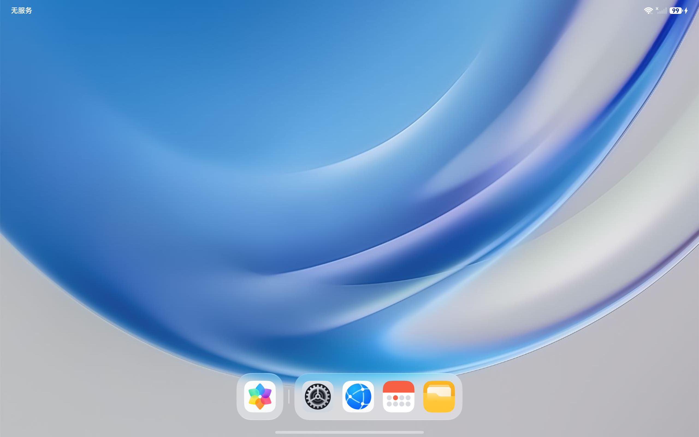
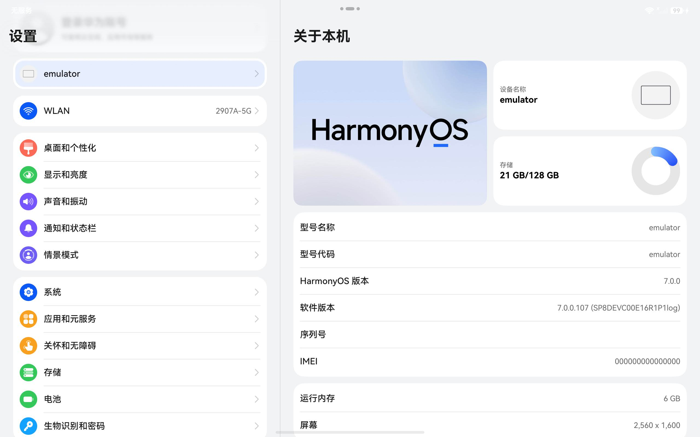

# 小米平板 5 nabu：Android → OHOS 补丁教程包

使用本地 DevEco ARM64 平板镜像，应用本包的适配补丁，生成小米平板 5 可启动的 OHOS。包内整理了源码、预编译适配组件、引导工具和刷机脚本。

适用已解锁 Bootloader 的小米平板 5 Wi-Fi 版，代号 `nabu`。从 Android 开始，最终保留 OHOS。分区步骤会清空原 Android 应用与文件。

桌面，nabu 真机截图：



关于本机，HarmonyOS 7.0.0：



[下载配套文件](https://github.com/DavidMastrenet/nabu-ohos/releases/latest)，解压后按下面的文档操作。

按顺序阅读和操作：

1. [从 Android 安装](docs/01-从Android安装.md)
2. [调试与恢复](docs/02-调试与恢复.md)
3. [源码与构建](docs/03-源码与构建.md)
4. [当前适配状态](docs/04-适配状态.md)
5. [需要自己提供的输入](docs/05-输入文件.md)
6. [来源与包内容](docs/06-来源与包内容.md)

主要命令（细节和输入要求见安装文档）：

```powershell
.\tools.ps1
.\recovery.ps1
.\capture.ps1
.\images.ps1 --base D:\my-sdk\system-image-tablet-arm64
.\prepare.ps1
.\plan.ps1
.\partition.ps1 --apply
.\recovery.ps1
.\deploy.ps1
.\boot.ps1
.\status.ps1
```

目录：

```text
docs/       完整中文教程
scripts/    本地镜像补丁、固件导入、分区和部署脚本
patches/    配置差异、音频指令修改、开源运行时适配组件
code/       适配源码、内核补丁、构建脚本及上游源码
boot/       nabu UEFI、临时 Recovery、rEFInd 资源
tools/      Python 与 SSH 客户端
work/       安装时生成的本地文件
```

已运行桌面、硬件 GLES、Wi-Fi、亮度、电池、存储、自动旋转和 USB HID。蓝牙及部分外设仍待完成，热重启仍可能停在内核早期；具体结果以适配状态页为准。
